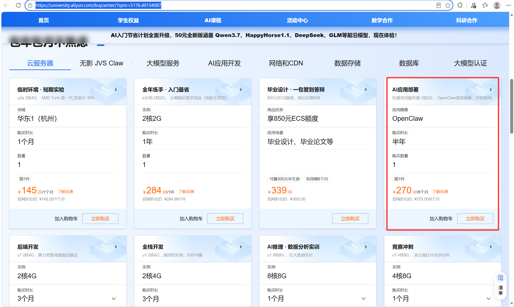

# 在 Ubuntu 服务器上部署个人 QQ 聊天助手

> 最后整理：2026-10-19  ·  文档类型：GitHub README  ·  用途：个人学习与实验

> 使用 Ubuntu + 1Panel + AstrBot + NapCat，将一个闲置 QQ 号接入大语言模型。

> **当前进度**：基础链路（服务器 → 1Panel → AstrBot → NapCat → QQ 登录）已全部跑通；当前处于**「仿真群友」人设与插件调优阶段**——人格提示词已演进到 v1.1（人格 + 群聊行为规则合并版），运维侧完成了 IO 治理与自身消息修复。进阶内容见 [第 8 节](#8-进阶仿真群友人设与插件配置)。

> 本教程面向个人学习和实验用途。请遵守 QQ、云厂商、模型服务商及相关法律法规，不要用于骚扰、刷屏、诈骗或其他违规行为。

## 目录

- [效果与架构](#效果与架构)
- [准备工作](#准备工作)
- [1. 购买并初始化 Ubuntu 服务器](#1-购买并初始化-ubuntu-服务器)
- [2. 安装 AstrBot](#2-安装-astrbot)
- [3. 部署 NapCat](#3-部署-napcat)
- [4. 配置端口和网络连接](#4-配置端口和网络连接)
- [5. 登录 QQ](#5-登录-qq)
- [6. 配置 AstrBot](#6-配置-astrbot)
- [7. 安装插件](#7-安装插件)
- [8. 进阶：仿真群友人设与插件配置](#8-进阶仿真群友人设与插件配置)
- [故障排查](#故障排查)
- [仓库结构](#仓库结构)
- [参考资料](#参考资料)
- [许可证](#许可证)

## 效果与架构

最终链路如下：

```text
QQ 用户
   │
   ▼
NapCat（QQ 协议侧）
   │  OneBot v11 / WebSocket
   ▼
AstrBot（机器人、模型和插件）
   │
   ▼
DeepSeek 或其他兼容提供商
```

## 准备工作

需要准备的：

- 一台可以安装 Ubuntu 22.04/24.04 的云服务器，建议至少 2 vCPU、2 GiB 内存。
- **AstrBot、NapCat**（都通过 Docker 运行，不需要手动安装）。
- 一个**闲置 QQ 号**，用于扫码登录 NapCat。
- 一个模型服务商账号和 API Key，例如 DeepSeek。

> 两个亲测有效的建议：每个打开的网页在配置好之前都尽量保留，不要急着关掉；每个阶段要复制的内容（Token、初始密码、外部地址等）都粘贴到一个地方统一保存，后面会反复用到。

> 云服务器规格和价格会随活动变化。购买时请以云厂商当前页面为准。

## 1. 购买并初始化 Ubuntu 服务器

### 1.1 购买服务器（学生优惠）

阿里云可以学生认证后领取 300 RMB 卡券，购买一个半年的 2 核 2G 的服务器：

[学生权益 - 阿里云云工开物](https://university.aliyun.com/buycenter/)

建议购买 openclaw 镜像的（有免费宽带）。



<p align="center"><em>图 1　服务器购买/学生权益页面</em></p>

镜像选择 Ubuntu：


<p align="center"><em>图 2　选择 Ubuntu 镜像</em></p>

### 1.2 安装 1Panel

购买后访问[轻量应用服务器控制台](https://swasnext.console.aliyun.com/servers/cn-guangzhou)，点击**远程连接**，在服务器终端执行 1Panel 官方提供的快速安装命令：

```bash
bash -c "$(curl -sSL https://resource.fit2cloud.com/1panel/package/v2/quick_start.sh)"
```

安装完成后，终端通常会输出 1Panel 访问地址、用户名和初始密码。请立刻复制到密码管理器中，并在首次登录后修改密码。


<p align="center"><em>图 3　在终端安装 1Panel</em></p>

### 1.3 放行 1Panel 访问端口

点击**更多操作 → 查看详情**进入服务器详情页，在阿里云服务器防火墙放行 1Panel 端口。我这次安装输出的是 `19146`：


<p align="center"><em>图 4　服务器详情</em></p>


<p align="center"><em>图 5　云防火墙放行 1Panel 端口</em></p>

如果无法打开 1Panel：

- 在云厂商安全组/防火墙中放行安装输出的 1Panel 端口。端口由安装过程生成，不一定是 `19146`，不要照抄截图里的端口，以你自己的终端输出和面板设置为准。
- 如果启用了 1Panel 自带防火墙，也要添加对应规则。
- 只允许自己的公网 IP 访问管理端口，不建议对 `0.0.0.0/0` 长期开放。

放行后在服务器的终端复制外部地址，用浏览器访问 1Panel。

## 2. 安装 AstrBot

进入 1Panel 后：

1. 打开 **应用商店**。
2. 搜索 `AstrBot`。
3. 点击安装。
4. 按需设置持久化目录和管理端口。
5. 记得往下滑勾选放行端口，只勾选确实需要的。

AstrBot WebUI 默认常见端口为 `6185`，但不同版本或安装方式可能有所不同，请以安装页面和容器日志为准。


<p align="center"><em>图 6　在 1Panel 应用商店安装 AstrBot</em></p>


<p align="center"><em>图 7　AstrBot 安装进度</em></p>

## 3. 部署 NapCat

### 3.1 使用 1Panel 编排创建容器

在 1Panel 中进入 **容器 → 编排 → 创建**，粘贴下面的配置。仓库中也提供了同样的文件：[`docker-compose.napcat.yml`](docker-compose.napcat.yml)。

```yaml
services:
  napcat:
    image: mlikiowa/napcat-docker:latest
    container_name: napcat
    ports:
      - "6099:6099" # NapCat WebUI；完成配置后建议限制来源
      - "3000:3000"
      - "3001:3001"
    environment:
      - NAPCAT_UID=0
      - NAPCAT_GID=0
    volumes:
      - ./config:/app/napcat/config
      - ./QQ:/app/.config/QQ
    restart: always
```

说明：

- `6099`：NapCat WebUI，首次配置会用到。
- `3000`、`3001`：NapCat 的 HTTP/WebSocket 相关端口，是否需要公网暴露取决于你的连接方式。


<p align="center"><em>图 8　创建 NapCat 编排</em></p>


<p align="center"><em>图 9　NapCat 编排配置</em></p>

创建并启动容器后，进入 **容器 → NapCat → 日志**，确认容器已经正常启动。

## 4. 配置端口和网络连接

### 4.1 需要关注的端口

必须到阿里云的安全组放行端口 `6185`（AstrBot WebUI）和 `6099`、`3000`、`3001`（NapCat）；如果开启了 1Panel 的防火墙，同理也要放行。

| 端口 | 用途 | 建议 |
| --- | --- | --- |
| `19146` | 1Panel 管理后台 | 仅允许自己的 IP 访问 |
| `6185` | AstrBot WebUI | 仅允许自己的 IP 访问 |
| `6099` | NapCat WebUI | 配置完成后限制来源或改用 SSH 隧道 |
| `3000`、`3001` | NapCat 连接相关端口 | 按实际拓扑开放，不要盲目全网开放 |
| `6199` | AstrBot 的 OneBot v11 WebSocket 服务示例端口 | 尽量只在容器网络/内网可达 |

云安全组和 1Panel 防火墙(如开启)需要分别检查。只配置其中一处，另一处仍可能拦截连接。


<p align="center"><em>图 10　云安全组端口配置</em></p>


<p align="center"><em>图 11　1Panel 防火墙配置</em></p>

### 4.2 在NapCat配置 WebSocket Sever

1. 在NapCat创建 WebSocket 服务端（参考图13填写）。
2. 如果设置了 Token，客户端必须使用相同 Token(一般不需要填写)。


<p align="center"><em>图 12　NapCat 网络配置</em></p>


<p align="center"><em>图 13　WebSocket 服务端配置</em></p>

### 4.3 在NapCat配置 WebSocket Client

1. 在NapCat创建 WebSocket 服务端（参考图15填写）。

填 URL 之前必须先拿到一个 NapCat 容器能够访问的地址。NapCat 运行在 Docker 容器内部，容器里的 `127.0.0.1` 指向的是容器自身而不是宿主机，所以千万不要填 `127.0.0.1`。

2. 在 1Panel 终端执行：

```bash
ip route | awk '/default/ {print $3}'
```

通常会返回类似 `172.17.0.1` 或 `10.0.0.1` 这样的地址，填入 <AstrBot可达地址>
```
ws://<AstrBot可达地址>:6199/ws
```


<p align="center"><em>图 14　WebSocket 客户端配置</em></p>


## 5. 登录 QQ

### 5.1 获取 NapCat WebUI Token

在 NapCat 的启动日志中查找 WebUI Token 并复制。然后在浏览器访问 NapCat WebUI（我的是 `http://IP:6099`，把 IP 换成你自己服务器的公网 IP）：

```text
http://8.xxx.xx.xxx:6099
```

输入 Token 后进入 WebUI，选择闲置 QQ 号并扫码登录。


<p align="center"><em>图 15　NapCat Token 和二维码</em></p>

### 5.2 确认连接状态

登录成功后：

- NapCat 日志不应持续出现登录失败或重连错误。
- AstrBot 的 OneBot 平台状态应显示在线或已连接。
- 用另一个 QQ 号发送一条简单消息，观察 AstrBot 是否收到事件。

## 6. 配置 AstrBot

### 6.1 首次登录

在 AstrBot 容器日志中查找初始登录信息。第一次登录后会强制要求更改密码，请使用高强度密码，不要继续使用日志中的初始密码。


<p align="center"><em>图 16　AstrBot 登录信息</em></p>


<p align="center"><em>图 17　修改 AstrBot 密码</em></p>

改完密码进入首页后，根据快速引导进行配置。


<p align="center"><em>图 18　AstrBot 首页快速引导</em></p>

### 6.2 配置模型提供商（DeepSeek）

可以去 DeepSeek 购买 API，充值个 5 块钱个人使用完全够用：[DeepSeek 开放平台](https://platform.deepseek.com/usage)

1. 在 DeepSeek 开放平台创建 API Key。
2. 确认账户有可用额度。
3. 在 AstrBot 的模型提供商配置中，新增 DeepSeek。
4. 填写 API Base URL：

```text
https://api.deepseek.com/v1
```

5. 填写复制的 API Key。
6. 往下滑选择**获取模型列表**，选择 `deepseek-v4-flash` 就行。


<p align="center"><em>图 19　DeepSeek API Keys</em></p>


<p align="center"><em>图 20　DeepSeek 账户/充值页面</em></p>


<p align="center"><em>图 21　AstrBot 提供商配置</em></p>


<p align="center"><em>图 22　选择模型</em></p>

### 6.3 启用 QQ 平台

在 AstrBot 中：

1. 选择配置平台，选择 **OneBot v11**。
2. 检查 WebSocket 服务端端口、路径和 Token 是否与 NapCat 客户端一致。
3. 保存后查看平台日志，确认连接状态正常。


<p align="center"><em>图 23　AstrBot 平台配置</em></p>


<p align="center"><em>图 24　AstrBot 模型配置</em></p>

### 6.4 设置人格

往下滑选择**人格**，在人格配置页面：

- 创建一个人格 ID。
- 编写系统提示词，明确机器人的语气、边界和不应执行的操作。提示词不用自己硬写，可以和网页版 AI 聊聊让它生成系统提示词（推荐 DeepSeek 老师）。
- 只授予必要的插件和工具权限。

本仓库附的完整示例：[人格提示词：DeepSeek · 蓝色大肥鱼](docs/persona-大肥鱼.md)


<p align="center"><em>图 25　创建人格</em></p>


<p align="center"><em>图 26　人格提示词</em></p>

点击**保存退出**即可，然后用测试 QQ 号发送消息验证回复。

## 7. 安装插件

为机器人添加插件——在 AstrBot 插件市场探索即可，每个插件都有详细的官方文档说明，还是通俗易懂的。安装前建议：

1. 阅读插件官方文档和权限说明。
2. 检查插件是否会访问文件、执行命令或调用外部服务。
3. 先在测试环境安装，确认日志和资源占用正常。
4. 记录插件版本，避免无意间自动升级导致配置变化。


<p align="center"><em>图 27　AstrBot 插件市场</em></p>

## 8. 进阶：仿真群友人设与插件配置

基础链路跑通后，下一个目标是让机器人**像真人群友一样混在群里，而不是当客服**。本节记录当前的人设方案与插件配置，方法论参考开源项目 [qq-bridge](https://github.com/Derpyu520/qq-bridge)（把 DSH agent 桥接到 QQ 做"仿真群友"的二代预设）。

### 8.1 设计原则：提示词分两层

| 层 | 管什么 | 放在哪 |
|---|---|---|
| 人格层 | AI 是谁：身份、性格、说话风格、梗、雷点 | AstrBot「人格设定」 |
| 行为层 | 怎么在群里活着：去 AI 味铁律、分条节奏、潜水礼节、汇报禁令 | 人格提示词的第二部分（已合并） |

两层合起来的完整版：[人格提示词 v1.1：DeepSeek 小鲸鱼](docs/persona-小鲸鱼-v1.1.md)。v1.1 已按实际安装的插件清单重写，删除了不存在的自研工具协议。

### 8.2 当前插件清单与配置要点

| 插件 | 版本 | 作用 | 配置要点 |
|---|---|---|---|
| 主动消息 (Proactive Chat) | v1.2.6 | 主动发言、动态调度、免打扰、TTS | **频率调低**：主动开话题由人格规则驱动，插件只做兜底，否则两边同时主动会刷屏 |
| Self Learning 自主学习 | v4.3.0 | 黑话学习、社交关系、好感度 | **关闭"自适应人格演化"**：它会改写人格，与固定人设冲突；只用黑话/好感度部分 |
| 表情包管理器 | v5.1.0 | 表情包 AI 发送、WebUI 管理、资源广场 | 用 marker 协议（模型写 `&&分类名&&`，发送前插件替换为图）；升级后需在设置中心恢复默认提示词模板 |
| 专业戳一戳 | v2.1.1 | 戳戳响应（反戳、图库、禁言等） | 默认即可 |
| 万能解析器 | v1.5.7 | 链接解析（B 站、抖音、小红书等） | 默认即可 |
| 点歌 / QQ空间 / Steam 状态监控 | — | 按需使用 | 与人格无关，不主动提 |

### 8.3 踩坑记录（重要配置项）

- **机器人对自己发的图接话**：根因是 AstrBot 主配置 `ignore_bot_self_message` 为 `false`，自身消息回显后重新进上下文。改为 `true` 即修复（WebUI 保存即生效），提示词层也有兜底规则。
- **表情包不发/乱发**：插件升级后提示词模板未重置是高频原因；标记形式可在「标签与匹配」收紧为只认 `&&分类名&&`。
- **自动收集混入自己发的图**：`auto_collect` 开启时，回显的自己发的图可能进待审核列表，记得清理。

### 8.4 架构说明：marker 协议 vs 工具调用

表情包管理器证明了一条轻量路线：**模型不调工具，而是在回复文本里写标记，插件通过 hook 拦截响应、把标记替换成真图**（`on_llm_request` 注入分类提示 → `on_llm_response` 扫描标记 → `on_decorating_result` 替换发送）。分条发送等结构化行为都可以照这个模式做，比自研工具链省一大截工作量；只有"条件判断型"行为（如等某人回复再说话）才需要更重的方案，这部分由主动消息插件部分覆盖。

## 故障排查

### 浏览器无法打开面板

- 检查服务是否运行：`docker ps`、1Panel 容器状态和日志。
- 检查云安全组和 1Panel 防火墙是否同时放行。
- 确认访问的是实际端口，而不是照抄截图里的端口。
- 若只允许本地访问，使用 SSH 隧道或 VPN，不要直接开放到公网。

### NapCat 与 AstrBot 无法建立 WebSocket

- 确认 WebSocket 方向只有一套配置在工作。
- 确认 URL 的主机、端口、路径 `/ws` 和 Token 完全一致。
- 确认 AstrBot 的 WebSocket 服务端监听的是 `0.0.0.0:6199` 而不是 `127.0.0.1:6199`（`netstat -tlnp | grep 6199`）。
- 跨容器时不要使用 `127.0.0.1`——容器里的 `127.0.0.1` 指向 NapCat 自身，正确地址的获取方法见 4.3 节。
- 如果使用宿主机端口，检查 AstrBot 是否真的映射了 `6199`。

### QQ 扫码后仍然离线

- 检查 NapCat 日志中的二维码有效期、设备验证和重连信息。
- 使用闲置 QQ 号，不要频繁重复扫码。
- 确认容器的数据目录有持久化，否则重建容器可能丢失登录状态。

### 模型调用失败

- 检查 API Key 是否有效、是否有余额或额度。
- 检查 API Base URL 是否与服务商文档一致。
- 在 AstrBot 中重新获取模型列表，选择当前可用模型。

### Workbench 远程连接超时（SocketTimeoutException）

偶发、且 CPU/内存并未占满时，优先怀疑**云盘 IO 限流**：部署期密集拉镜像/起容器会把小规格实例的云盘 IOPS 打满，限流期间云助手无法注入登录公钥，表现为连接建立超时。治理要点：一键诊断确认受限、加 swap、journald 限额、Docker 日志轮转。持续失败时另查安全组是否放行 `100.104.0.0/16 → TCP 22`（VPC 内网连接必需，注意防火墙 ≠ 安全组）。

### 机器人对自己发的图片/表情接话

OneBot 会把机器人自己发的消息回显成新事件。确认 AstrBot 主配置 `data/config/abconf_*.json` 中 `ignore_bot_self_message` 为 `true`；仍复现则去 NapCat 关闭「上报自身消息」。提示词层已有「自身消息识别」兜底规则。

### 表情包不发送或乱发

- 插件升级后未重置提示词模板：设置中心 → 提示词模板 → 恢复默认模板 → 保存并应用。
- 标记形式误触发：设置中心 → 标签与匹配，收紧为只认 `&&分类名&&`。
- 自动收集开启时，检查待审核列表是否混入了机器人自己发的图。


## 仓库结构

```text
.
├── README.md
├── docker-compose.napcat.yml
├── docs/
│   ├── persona-大肥鱼.md          # v1 人格（早期版本，存档）
│   └── persona-小鲸鱼-v1.1.md     # 人格 + 群聊行为规则合并版（当前使用）
│   
├── images/
│   ├── 01-server-purchase.png
│   ├── ...
│   └── 28-plugin-market.png
├── .gitignore
└── image-map.txt
```

## 参考资料

文档：

- [1Panel 文档](https://1panel.cn/docs/v2/)
- [AstrBot 官方文档](https://docs.astrbot.app/what-is-astrbot.html)
- [AstrBot 官方网站](https://astrbot.app/)
- [NapCatQQ Shell 部署指南](https://napneko.github.io/guide/boot/Shell)
- [OneBot v11 标准](https://11.onebot.dev/)
- [DeepSeek 开放平台](https://platform.deepseek.com/)

应用仓库：

- [NapNeko/NapCatQQ](https://github.com/NapNeko/NapCatQQ) — Modern protocol-side framework based on NTQQ
- [AstrBotDevs/AstrBot](https://github.com/AstrBotDevs/AstrBot) — AI Agent Assistant & development framework that integrates lots of IM platforms, LLMs, plugins and AI features

人设参考（"仿真群友"方法论来源）：

- [Derpyu520/qq-bridge](https://github.com/Derpyu520/qq-bridge) — 把 DSH agent 桥接到 QQ 的二代仿真群友项目；本仓库人格提示词的行为规则移植自其二代预设
- [anka-afk/astrbot_plugin_meme_manager](https://github.com/anka-afk/astrbot_plugin_meme_manager) — 表情包管理器（marker 协议参考实现）

